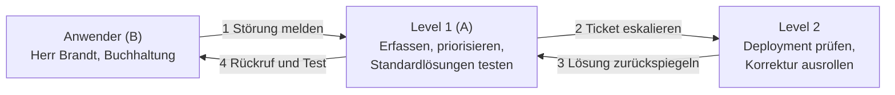

# Incident-Management bei der 418 AG

| Teil | Dauer | Bis Minute |
| --- | --- | --- |
| Einstieg | 0:20 | 0:20 |
| Video 1 | 1:45 | 2:05 |
| Zwischenerklärung mit Animation | 2:00 | 4:05 |
| Video 2 | 0:50 | 4:55 |
| Kommunikationsmodelle | 1:30 | 6:25 |
| Stärken und Grenzen | 1:00 | 7:25 |
| Reflexion und Abschluss | 0:45 | 8:10 |

## Einstieg: Szenario und User Stories

**Sprechertext (ca. 0:20):** Willkommen bei der 418 AG. Heute wurde eine neue Version des Rechnungsmanagementtools ausgerollt. Seitdem funktioniert der Button „Abschicken“ nicht mehr. Wir zeigen, wie der IT-Service so einen Fehler bearbeitet und wie er mit einem aufgebrachten Anwender umgeht.

*Einblendung: beide User Stories als Kurzfassung, jeweils ca. 5 Sekunden.*

**Anwender:** Als Anwender des Rechnungsmanagementtools möchte ich Rechnungen über den Button „Abschicken“ versenden können, damit ich meine Rechnungen nach der Bearbeitung ordnungsgemäß einreichen kann.

Seit dem neuen Deployment funktioniert der Button nicht mehr. Beim Betätigen wird die Rechnung nicht versendet, und es erfolgt keine Reaktion.

**IT-Service-Mitarbeiter:** Als IT-Service-Mitarbeiter der 418 AG möchte ich den Fehler am „Abschicken“-Button analysieren und beheben, damit die Anwender ihre Rechnungen wieder ordnungsgemäß versenden können.

Der Fehler ist nach dem neuen Deployment aufgetreten. Daher soll geprüft werden, ob das Deployment die Ursache ist und welche Anpassungen nötig sind.

## Video 1: Das erste Telefonat

Das Gespräch zeigt, wie A trotz Beleidigungen sachlich bleibt und den Fehler sauber weitergibt. Der Name Brandt, die Frist um 16 Uhr und die Ticketnummer sind Ergänzungen von mir. Die Frist erklärt den Stress von B und liefert das Beispiel für das Eisberg-Modell.

*Einblendung: „Montag, 15:10 Uhr, Service-Desk der 418 AG“. A sitzt am Headset, B am Schreibtisch, Splitscreen.*

**A:** IT-Service-Desk der 418 AG, mein Name ist [Name]. Was kann ich für Sie tun?

**B:** Endlich! Ich hänge seit zehn Minuten in der Warteschleife. Brandt, Buchhaltung. Euer Rechnungstool ist schon wieder kaputt!

**A:** Guten Tag, Herr Brandt, danke fürs Warten. Was genau funktioniert nicht?

**B:** Der Button „Abschicken“! Ich klicke drauf, und nichts passiert. Die Rechnungen müssen bis 16 Uhr raus, und ich sitze hier und kann nichts machen!

**A:** Ich fasse kurz zusammen: Sie klicken auf „Abschicken“, es passiert nichts, und Sie haben eine Frist um 16 Uhr. Kommt eine Fehlermeldung? Und seit wann tritt das auf?

**B:** Keine Meldung, gar nichts. Seit eurem tollen Update heute. Den Kollegen geht es genauso.

**A:** Danke, das hilft mir weiter. Ich lege dafür ein Ticket an. Bitte laden Sie die Seite einmal neu und versuchen es noch mal.

*Einblendung: „Ticket angelegt“.*

**B:** *(klickt, genervt)* Nichts.

**A:** Dann schließen Sie bitte den Browser ganz und öffnen ihn neu.

**B:** *(seufzt, klickt)* Immer noch nichts.

**A:** Als letzten Schritt starten Sie bitte einmal den PC neu. Ich bleibe am Telefon.

**B:** Das ist doch nicht Ihr Ernst!

*Schnitt. Einblendung: „Drei Minuten später“.*

**B:** Geht immer noch nicht! Sitzen bei euch nur Praktikanten? Sie haben doch überhaupt keine Ahnung!

**A:** Ich verstehe, dass das ärgerlich ist, gerade mit Ihrer Frist. Es tut mir leid, dass Sie aufgehalten werden. Bitte bleiben wir aber sachlich, damit wir das schnell lösen.

**A:** An Ihrem PC liegt es nicht. Ich gebe das Ticket jetzt mit hoher Priorität an unseren Level 2, dort wird das Deployment geprüft. Ihre Ticketnummer ist 4711. Wir melden uns, sobald es eine Lösung gibt.

**B:** Das will ich auch hoffen! *(legt auf)*

## Zwischenerklärung: Vom Ticket zur Lösung

Die Animation zeigt den Weg des Tickets durch die Level. Der Sprechertext läuft parallel und dauert ca. 2:00 Minuten.

**1. Einordnen:** Was ist hier passiert? Herr Brandt hat einen Incident gemeldet, also eine ungeplante Störung eines IT-Services. Ziel des Incident-Managements ist, den Service möglichst schnell wiederherzustellen.

**2. Priorisieren:** Zuerst klassifiziert A das Problem. Die Priorität ergibt sich aus Auswirkung und Dringlichkeit.

| Merkmal | Einstufung | Begründung |
| --- | --- | --- |
| Kategorie | Anwendung, Rechnungsmanagement | Fehler liegt in der Software |
| Auswirkung | Hoch | Mehrere Anwender betroffen, Kernprozess steht |
| Dringlichkeit | Hoch | Frist heute um 16 Uhr |
| Priorität | Hoch | Hohe Auswirkung und hohe Dringlichkeit |

**3. Eskalieren:** Level 1 nimmt die Meldung an, dokumentiert sie und probiert Standardlösungen aus. Hier helfen sie nicht, und alles deutet auf das Deployment hin. Deshalb gibt A das Ticket mit allen Informationen an Level 2 weiter.

**4. Lösen:** Level 2 prüft das Deployment und findet den Fehler. Eine korrigierte Version wird erneut ausgerollt, und der Button funktioniert wieder.

**5. Zurückspiegeln:** Level 2 dokumentiert Ursache und Lösung im Ticket und gibt es an Level 1 zurück. Level 1 bleibt Ansprechpartner für den Anwender. Deshalb ruft A jetzt Herrn Brandt zurück.

## Video 2: Der Rückruf

Der Fehler ist behoben, aber B bleibt unfreundlich. A bleibt freundlich, lässt die Lösung bestätigen und schließt erst dann das Ticket.

*Einblendung: „15:50 Uhr, Rückruf“.*

**A:** Guten Tag, Herr Brandt, hier ist [Name] vom IT-Service-Desk. Ich rufe wegen Ticket 4711 an.

**B:** Ach, Sie schon wieder. Wurde auch Zeit.

**A:** Ich habe gute Nachrichten: Der Fehler ist behoben. Die Ursache lag im letzten Deployment, unsere Kollegen haben eine korrigierte Version aufgespielt. Bitte laden Sie die Seite einmal neu und testen den Button.

**B:** *(klickt)* Ja, geht. Hätte aber auch nie kaputtgehen dürfen. Was ist das hier eigentlich für ein Saftladen?

**A:** Ich verstehe, dass Sie das viel Zeit gekostet hat. Dafür entschuldige ich mich im Namen der IT. Schaffen Sie Ihre Frist noch?

**B:** Gerade so. Kein Dank an euch.

**A:** Das freut mich trotzdem. Dann schließe ich das Ticket jetzt. Kann ich sonst noch etwas für Sie tun?

**B:** Nein. Hoffentlich nicht so bald wieder.

**A:** Dann wünsche ich Ihnen noch einen schönen Tag, Herr Brandt. Auf Wiederhören.

*B legt wortlos auf. A atmet einmal durch und schließt das Ticket.*

## Kommunikationsmodelle: Was im Gespräch passiert ist

Drei Modelle erklären, warum das Gespräch nicht eskaliert ist, obwohl B beleidigend wurde. Die Absätze sind Sprechertext für ca. 1:30 Minuten.

**Sender-Empfänger-Modell:** Der Sender codiert eine Nachricht, der Empfänger decodiert sie. Am Telefon hört A nur die Stimme und sieht den Bildschirm von Herrn Brandt nicht. Dazu kommt der Stress als Störung. Deshalb fasst A das Problem zusammen und prüft so, ob die Nachricht richtig angekommen ist.

**4-Ebenen-Modell:** Nach Schulz von Thun hat jede Aussage vier Seiten. Das zeigt der Satz „Euer Tool ist schon wieder kaputt!“:

| Ebene | Was Herr Brandt mitteilt |
| --- | --- |
| Sachinhalt | Das Tool funktioniert nicht. |
| Selbstoffenbarung | Ich stehe unter Druck. |
| Beziehung | Ihr bekommt das nicht in den Griff. |
| Appell | Repariert das sofort! |

Hört A nur die Beziehungsebene, fühlt er sich angegriffen und wird selbst laut. A hört stattdessen auf Sache und Appell und reagiert auf den Druck.

**Eisberg-Modell:** Nur ein kleiner Teil der Kommunikation liegt sichtbar über der Oberfläche. Sichtbar sind die Beleidigungen. Darunter liegen die Frist und vermutlich die Sorge, Ärger zu bekommen. Die Beleidigung gilt also dem Problem und nicht A als Person.

Erklärung von IT-Service-Mitarbeiter was sein Ziel ist und wie er damit umgeht.

## Stärken und Grenzen

Die Methoden haben den Fehler gelöst, die Störung aber nicht verhindert. 

| Methode oder Tool | Stärke | Grenze im Szenario |
| --- | --- | --- |
| Ticketsystem | Alles ist dokumentiert, nichts geht bei der Übergabe verloren | Hilft nur, wenn es vollständig gepflegt wird |
| Priorisierung | Dringendes wird objektiv zuerst bearbeitet | Einstufung hängt von den Angaben im Gespräch ab |
| Standardlösungen | Lösen viele einfache Fehler schnell | Hier wirkungslos, sie haben B zusätzlich verärgert |
| Level-Modell | Klare Zuständigkeiten, Spezialisten bleiben frei | Jede Übergabe kostet Zeit |
| Erneutes Deployment | Behebt die Ursache dauerhaft | Löst den Fehler erst nach der Analyse, die Frist bleibt in Gefahr |
| Aktives Zuhören | Beruhigt und klärt Missverständnisse | Macht unfreundliche Anwender nicht zwingend freundlich |
| Kommunikationsmodelle | Erklären, was im Gespräch passiert | Vereinfachen, und Gedanken des Gegenübers bleiben Vermutungen |

**Kritischer Punkt:** Mehrere Anwender meldeten den Fehler erst nach dem Deployment. Ein kurzer Funktionstest direkt nach dem Ausrollen hätte ihn früher gezeigt. Hätte der Service-Desk von dem Deployment gewusst, hätte A die Standardschritte kürzen können.

## Reflexion und Abschluss

A hat die Situation gelöst, weil er bei der Sache geblieben ist und nicht auf die Angriffe eingestiegen ist.

**Sprechertext:** Herr Brandt blieb bis zum Schluss unfreundlich, trotzdem war das Gespräch erfolgreich. A hat zugehört, zusammengefasst und Verständnis für die Lage gezeigt. Er hat sich für die Störung entschuldigt, aber nicht für sich selbst, und eine Grenze gesetzt. Er hat Beleidigungen nicht persönlich genommen und das Gespräch freundlich beendet.

Eines können wir daraus mitnehmen: Im IT-Service geht es nicht darum, dass am Ende alle zufrieden sind. Es geht darum, den Service wiederherzustellen und professionell zu bleiben. Beim nächsten Mal würden wir die Standardschritte kürzen, sobald klar ist, dass viele Anwender betroffen sind. Danke fürs Zuschauen!

## Noch zutun:

- [ ] Rollen A und B sowie Sprecher festlegen
- [ ] Modelle um eins ergänzen
- [ ] Probelauf stoppen und Text bei Bedarf kürzen/verlängern
- [ ] Finale Aufnahme + Animationen
- [ ] Schnitt
- [ ] Abgabe